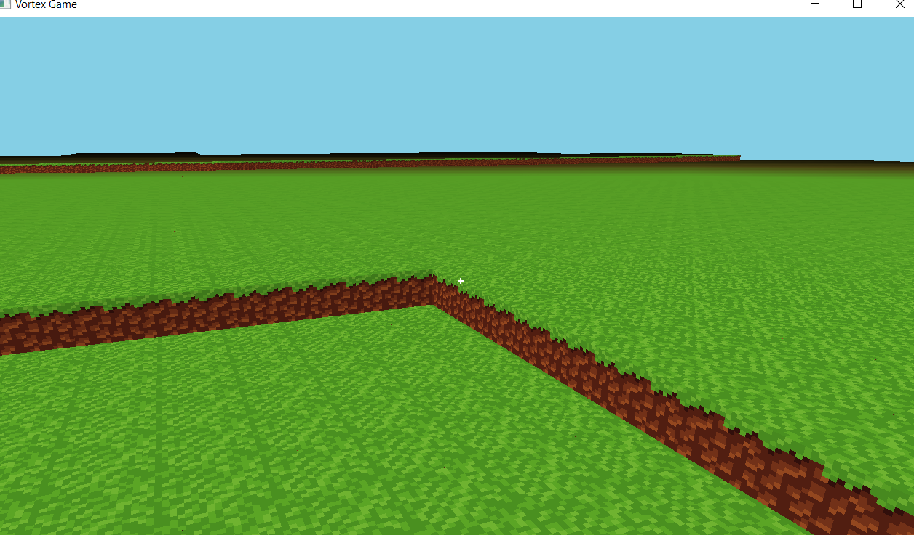

# Legend of Virelia

Legend of Virelia is a Java voxel game built on LWJGL/OpenGL. The repository contains a small reusable engine layer, game and world systems, a client/server simulation, a desktop launcher, assets, shaders, and Gradle build scripts.

This README is the project home. Follow the numbered guides in order, or use each guide's previous/next links to move through the documentation.

## What is in the project?

- A first-person voxel world made from 16 × 96 × 16 chunks.
- Procedural terrain generation, chunk meshing, block placement and breaking, lighting, and flowing water.
- A client loop for input and rendering plus a server-authoritative world state. `Main` currently connects these with an in-process queue bridge; this is not yet a network multiplayer transport.
- An OpenGL rendering layer, GLSL shaders, a small component UI system, and a Windows desktop launcher.

## Make your own game from this codebase

The repository is currently a runnable game application, not a separately packaged engine library. The `org.engine` and parts of `org.game` are reusable source packages; the game-specific startup and rules are under `org.legendofvirelia`.

1. Build and run the unmodified game once.
2. Decide what to reuse: window/loop/rendering, voxel world, player, UI, or command system.
3. Start by changing one visible feature—blocks, terrain, controls, or HUD—then run and review it.
4. Move your game rules into your own application package as they grow; keep shared engine code separate from game-specific code.
5. Keep the current in-process server bridge for local experiments. Add a real transport and stable IDs only if you need remote multiplayer or saved worlds.

The [Extending the engine guide](docs/extending-the-engine.md) turns this into a file-by-file plan.

## Run it

Requirements: Java 21 or newer for the game source (it uses Java 21 APIs), a graphics driver supporting OpenGL 3.3+, and Windows for the provided `.bat` launcher. The launcher source itself is compiled for Java 17, but building/running the full project requires the newer JDK.

From the project root:

```powershell
./gradlew.bat build
./gradlew.bat run
```

Or start the desktop launcher with `launcher/LaunchGame.bat`. It builds the launcher JAR and opens the launcher UI; use **Build & Play** there to build and start the game. Gradle tasks copy assets, shaders, runtime libraries, and the launcher into `build/`.

Controls: WASD move, Space jump, Left Ctrl sprint, Left Shift crouch, R reset, mouse buttons break/place, B switches mouse action mode, 1–5 select a hotbar block, Y toggles debug output, F11 toggles fullscreen, and Esc exits.

## Documentation

1. [Architecture and system flow](docs/architecture.md) — startup and the main runtime flow.
2. [Client/server and world state](docs/client-server-world-state.md) — commands, update order, and world ownership.
3. [World generation](docs/world-generation.md) — chunk generation, terrain layers, and streaming.
4. [World and block data](docs/world-and-rendering.md) — coordinates, block registration, and lighting updates.
5. [Rendering and meshes](docs/rendering-pipeline.md) — mesh construction, GPU buffers, render passes.
6. [Shaders, textures, and models](docs/shaders-textures-models.md) — GLSL, atlas, JSON models, and adding assets.
7. [API and reusable classes](docs/api-reference.md) — core class map and short extension examples.
8. [Extending the engine](docs/extending-the-engine.md) — adding features with the existing architecture.
9. [UI and launcher](docs/ui-and-launcher.md) — UI components and desktop launcher.
10. [Project structure and workflow](docs/project-structure.md) — folders, build commands, and contributor checklist.

## Screenshots

The repository already contains screenshots for the current water behavior, lighting/shader appearance, launcher, and gameplay. Replace or add files under `screenshots/` as the project evolves; update the links here if filenames change.

| Feature | Screenshot |
| --- | --- |
| Water logic |  |
| Lighting and shader appearance |  |
| Launcher |  |
| Gameplay view |  |

## Current scope and caveats

The client/server split and command protocol are present, but `Main.CommunicationBridge` is local and in-process. There is no socket transport or persistent save/load layer visible in the current entry point. Chunk generation is asynchronous; generated chunks are installed on the world-owning update path. Water placed by the player flows horizontally on timed updates, while generated water is not activated as a flowing source.

## License

See [LICENSE](LICENSE).
