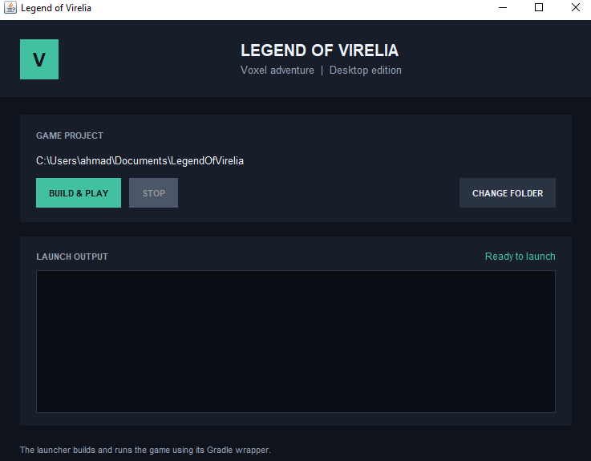

# 9. UI and launcher

[← Previous: Extending the engine](extending-the-engine.md) · **9 / 10** · [Next: Project structure →](project-structure.md)

## UI classes

`UIElement` stores position, size, visibility, and a `Mesh2D`. Its subclasses render through `UIRenderer`.

| Class | Purpose |
| --- | --- |
| `ColorRect` | RGBA rectangle |
| `Label` | Text using `fonts/Minecraft.ttf` |
| `Container` | Child grouping with scissor clipping |

Example composition from the HUD pattern:

```java
ColorRect panel = new ColorRect(8, 8, 430, 30, 0.02f, 0.03f, 0.05f, 0.72f);
Label text = new Label(8, 8, 430, 30, "FPS: 60", 14);
```

Add elements to an owner list, position them during layout/resize, draw them after the 3D pass, and destroy them during cleanup. `setPosition`, `setSize`, and `Label.setText` recreate meshes; don’t call them on every frame without a reason. Mouse events and hit-testing are not implemented.

## Launcher

`launcher/LaunchGame.bat` builds `Launcher-1.0-SNAPSHOT-all.jar` and starts it. Source is `launcher/src/main/java/org/legendofvirelia/launcher/Launcher.java`. The UI selects a project directory, starts build/play, displays Gradle output, and can stop the launched process.



Edit launcher source, then run `./gradlew.bat launcherJar` to rebuild. The generated JAR is an output, not the source of truth.

## Usage example (pseudocode): add a button

**Pseudocode only.** `UIElement` currently provides drawing/layout primitives; the engine does not yet supply button input events.

```text
class Button extends UIElement:
    draw(uiRenderer, windowSize): draw background and label
    contains(mousePosition): return whether pointer is inside bounds
    onClick(): run assigned action

client input:
    if left mouse pressed and button.contains(pointer):
        button.onClick()
```

Also add the button to the UI owner, relayout it on resize, and destroy its mesh during cleanup.

[← Extending the engine](extending-the-engine.md) · **9 / 10** · [Next: Project structure →](project-structure.md)
